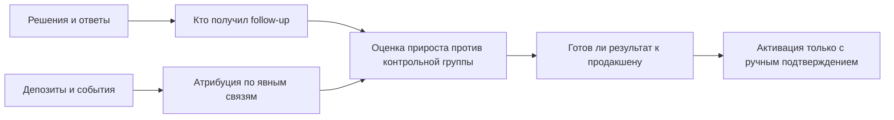

[](https://github.com/ermolaevmakar742-ai/uplift-copilot/actions/workflows/tests.yml)

# Uplift Copilot

Движок, который отвечает на вопрос: **сработало ли сообщение, или игрок сделал бы депозит и без него.**

## Зачем это нужно

CRM-менеджер отправил игроку follow-up, через час игрок внёс депозит. Классическая аналитика запишет это как победу сообщения. Но игрок, который собирался внести депозит, с меньшей вероятностью отвечает на письма. Оценка «смотрели и потом сделали» завышает эффект в разы, и бизнес платит за коммуникации, которые ничего не приносят.

Uplift Copilot решает это способом, который в маркетинге называют intent-to-treat:

1. Часть игроков случайно попадает в контрольную группу (10%), им follow-up не отправляют.
2. Сравнивается не «кто ответил», а доля депозитов в двух группах целиком.
3. Разница долей и есть честный прирост: то, что сообщение создало сверх того, что произошло бы само.

Проект вырос из одного вопроса: как измерять CRM-коммуникации так, чтобы цифры можно было показывать финансовому директору.

## Как это устроено



Данные проходят четыре слоя:

| Слой | Что делает | Почему это важно |
|---|---|---|
| Capture | Записывает каждое решение, отправленный ответ и исход | Не «переписали историю»: запись дописывается, но не меняется |
| Attribution | Связывает исход с решением по явным идентификаторам и времени | Если связать нельзя, система так и говорит, а не притягивает |
| Evaluation | Считает доли и разницу против контрольной группы | Разделяет «результат эксперимента» и «просто корреляцию» |
| Governance | Проверяет качество данных и право на активацию | Плохие данные блокируют продакшен, а не молча портят цифры |

Две идеи пронизывают весь код:

- **Неизвестное не равно нулю.** Если исход игрока не увидели, это UNKNOWN, а не «не сработало».
- **Fail closed.** Ошибка сбора данных отключает влияние на живых игроков, а не оставляет его включенным.

## Что в репозитории

| Пакет | Ответственность |
|---|---|
| `copilot_uplift` | Случайное распределение на группы, оценка прироста, ворота качества перед активацией |
| `copilot_evidence` | Единая модель наблюдений с происхождением; конфликт источников виден, а не спрятан |
| `copilot_decisions` | Журнал решений, который только дописывается |
| `copilot_attribution` | Правила связи исхода с решением |
| `copilot_bandit` | Выбор вариантов сообщений (исследовательский режим, LinUCB) |
| `copilot_llm_router` | Маршрутизация моделей с фолбэком, изолирована от боевого пути |
| `language_layer` | Локализация es/pt (Мексика, Перу, Колумбия, Эквадор, Бразилия) |
| `copilot_psychology` | Оценка состояния игрока. Встроенная защита: уязвимым (несовершеннолетние, самоисключение, финансовый кризис) дожим запрещён архитектурно |
| `copilot_secrets` | Шифрование и аудит доступа к ключам |

Остальные пакеты: `copilot_outcomes` (сбор исходов), `copilot_prediction`, `copilot_learning`, `copilot_shadow` (теневой анализ без влияния на игроков), `copilot_offers`, `copilot_programs`, `copilot_leads`, `copilot_acquisition`, `copilot_state_delta`, `copilot_contracts`, `copilot_voice`, `copilot_creative`.

## Быстрый старт

Нужен Python 3.11+ и `ffmpeg` (используется только в тестах креативов: `brew install ffmpeg` или `sudo apt-get install ffmpeg`).

```bash
python3.11 -m venv .venv
source .venv/bin/activate
pip install -r requirements.txt
python -m pytest tests -q
```

Это запускает тесты. API-сервера в публичной версии нет: репозиторий публикует ядро расчётов, а подключение к CRM-системе описано в README как интеграционный контракт.

Миграции применяются вручную и с проверкой плана:

```bash
python -m copilot_decisions.migrate        # показать SQL, ничего не менять
python -m copilot_decisions.migrate --apply
```

Все переключатели влияния на игроков по умолчанию выключены (`COPILOT_UPLIFT_ENABLED`, `COPILOT_BANDIT_ENABLED`, `COPILOT_DECISION_LEDGER_ENABLED` и другие, полный список в ветке master). Активация требует администратора.

## Статус и ограничения

Тесты: 909 passed / 0 failed на Python 3.11 (GitHub Actions на master).

Это исследовательский прототип, и вот его известные границы:

- Оценка прироста считается без доверительных интервалов и значимости. Разница долей даёт направление, но не доказанный эффект: нужен отдельный слой статистики.
- Эксперимент измеряет эффект назначения follow-up против тишины, а не эффект конкретного текста. Тексты рандомизируются отдельным экспериментом.
- Bandit хранит состояние в памяти процесса. Это исследовательский компонент, а не обучаемая продакшен-система.
- SQL-провайдер загружает данные частями. Обрезка и ошибки записи фиксируются и блокируют продакшен-допуск, но полный продакшен-снапшот ещё не проверялся.

## Для кого

Для команды, которая хочет перестать оправдывать CRM-бюджеты картинками воронки и начать считать реальный прирост. Архитектура рассчитана на встраивание в существующий продукт: каждый пакет имеет контракт, миграции и тесты изоляции, которые проверяют, что аналитика не мешает боевому пути.

## Принципы ответственного использования

- Работаем только с игроками оператора, которые дали согласие на коммуникации.
- Самоисключение и статус запрета контакта проверяются независимым блоком перед отправкой, тень-оценка не заменяет блокировку.
- Внешние данные о людях не собираются и не обогащаются. Только то, что игрок сказал сам, и его поведение в продукте.
