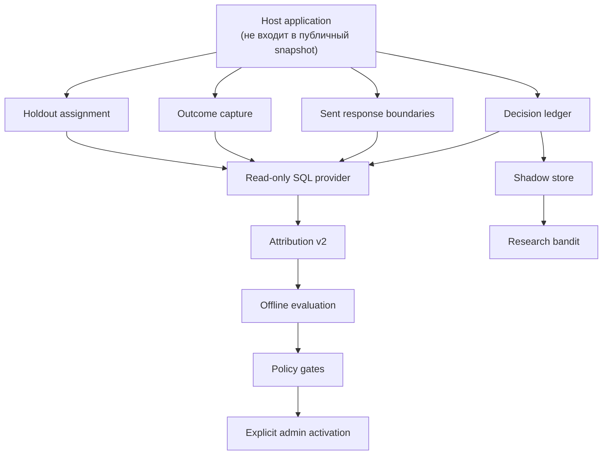

# Uplift Copilot

**Набор Python-модулей для измерения и аудита CRM-решений, attribution и экспериментальных политик.**

Uplift Copilot — исследовательский прототип архитектуры decision/measurement engine. В репозитории собраны контракты, детерминированные аналитические модули, адаптеры хранения, API-роутеры и тесты. Это **не готовая самостоятельная CRM-служба**: host-приложение/внутренний монолит, его точка входа и часть production-интеграций в публичную версию не входят.

> **Статус:** research / prototype. Не включайте production-влияние на основании одного факта, что unit-тесты проходят. В разделе [Текущие ограничения](#текущие-ограничения) перечислены известные блокеры корректности и безопасности.

## Задача и границы

Проект разделяет четыре разных процесса:

1. **Capture** — записать, какое решение было принято, какой ответ действительно отправлен и какой outcome был получен.
2. **Attribution** — определить, можно ли связать outcome с решением по явным идентификаторам или временным правилам.
3. **Evaluation** — посчитать наблюдаемые частоты и экспериментальные различия, отдельно показывая неизвестные и неполные данные.
4. **Governance** — хранить версии политик, проверять gates и требовать явного административного подтверждения для изменения состояния активации.

Цель архитектуры — не подменять неизвестное нулём, не называть корреляцию причинным эффектом и сохранять происхождение данных. Все реальные пользовательские коммуникации должны оставаться добровольными, прозрачными и подчиняться независимым правилам безопасности и responsible gambling.

## Структура модулей

| Модуль | Назначение | Текущий статус по коду |
|---|---|---|
| `copilot_decisions` | Контракт и запись decision ledger | Модуль записи; зависит от интеграции с host-приложением |
| `copilot_response_boundary` | Фиксация успешно отправленных частей ответа | Модуль записи; требует production-hook |
| `copilot_outcomes` | Контракты, capture и join outcomes | Адаптеры и хранилище; требует реальных источников |
| `copilot_attribution` | Direct и boundary-based temporal attribution | Детерминированные правила и evaluator |
| `copilot_evidence` | Provenance, fusion и arbitration evidence | Библиотека контрактов/адаптеров |
| `copilot_uplift` | Holdout assignment, offline evaluation, policy, gates и activation | Экспериментальный evaluator; production-допуск требует исправления известных методологических ограничений |
| `copilot_bandit` | LinUCB, replay и reward contracts | Research/shadow; не production learner |
| `copilot_prediction` | Наблюдения и статусы outcome | Детерминированные вспомогательные правила |
| `copilot_learning` | Critic и learner для теневых данных | Изолированные модули; интеграция зависит от host |
| `copilot_psychology` | Rule-based классификация структурированных сигналов и нейтральные стратегии | Shadow-only; не является самостоятельным risk-screening или enforcement |
| `copilot_secrets` | Шифрование секретов и admin API router | Модуль; фактическая auth-интеграция задаётся host-приложением |
| `copilot_llm_router`, `copilot_openrouter` | Конфигурация маршрутизации и API-клиент | Изолированные компоненты; production-подключение не подтверждено этой публичной версией |
| `language_layer` | Нормализация языка и локализация | Библиотека правил и тестов |
| `copilot_offers`, `copilot_programs`, `copilot_leads`, `copilot_acquisition` | Контракты и сервисная логика смежных CRM-сценариев | Отдельные модули; не равны готовому развернутому продукту |
| `copilot_shadow`, `copilot_state_delta`, `copilot_contracts` | Shadow-анализ, изменения состояния и общие контракты | Вспомогательные библиотеки |
| `copilot_creative`, `copilot_voice` | Работа с креативами и голосовыми сценариями | Отдельные компоненты; требуют собственных внешних зависимостей |

## Архитектура

Ниже показан **предполагаемый поток между модулями**, а не гарантия, что публичный репозиторий уже развёрнут как единое приложение.



Ключевые принципы:

- **Provenance first.** Источник и время наблюдения должны сохраняться вместе с данными.
- **Unknown is not zero.** Неизвестный outcome не превращается в отрицательное событие.
- **Shadow before influence.** Новая логика сначала проверяется без изменения пользовательских ответов.
- **Explicit activation.** Активация требует административного действия и повторной проверки условий.
- **Fail closed.** Ошибка, отсутствие данных или нарушение integrity не должны разрешать автоматическое влияние.
- **Data minimization.** В аналитические признаки следует передавать только необходимые first-party поля.

## Uplift: что именно считается

Текущий `copilot_uplift/estimator.py` реализует **маргинальную разницу наблюдаемых частот**, а не обученную conditional-uplift модель:

```text
rate(action)  = observed / (observed + no_outcome)
uplift(action) = rate(action) - rate(control)
```

Это не CATE/uplift-модель и не оценка индивидуального эффекта для конкретного пользователя. Наличие feature vector само по себе не делает эту оценку персонализированной: в текущем estimator частота считается по action-группе.

Статусы качества данных:

- `INSUFFICIENT_DATA` — недостаточно измеримых наблюдений;
- `OBSERVATIONAL` — нет подходящей рандомизированной контрольной группы;
- `EXPERIMENTAL` — есть рандомизированный контроль и минимальные объёмы;
- `CAUSAL_READY` — дополнительно присутствуют assignment probabilities.

Эти статусы описывают состояние входных данных и реализации. Даже `CAUSAL_READY` сам по себе не доказывает корректность дизайна эксперимента, отсутствие кластеризации, корректность окна наблюдения или статистическую значимость. Для этих выводов нужны отдельные проверки дизайна, единицы рандомизации, полноты capture и неопределённости оценок.

## Установка и тесты

Требуется Python 3.11+.

```bash
python3.11 -m venv .venv
source .venv/bin/activate
python -m pip install --upgrade pip
pip install -r requirements.txt
python -m pytest tests -q
```

Эта команда запускает тестовый набор. Она **не запускает CRM/API-сервер**: публичный snapshot не содержит самостоятельной точки входа приложения, Docker-конфигурации или полной host-интеграции.

### Статус тестирования

В README предыдущей версии и сообщении последнего публичного commit заявлено **896 passed / 0 failed**. Это результат, сообщённый автором проекта; в репозитории на момент обновления README нет GitHub Actions workflow и нет сохранённых CI-run результатов. Поэтому число не следует воспринимать как независимо проверенный CI-статус.

## Запуск миграций

Модули хранилищ предоставляют отдельные миграции. Они требуют настроенного `DATABASE_URL` и выполняются явно. Например:

```bash
# Сначала вывести план SQL без изменений:
python -m copilot_decisions.migrate

# Применять только после проверки плана и резервного копирования:
python -m copilot_decisions.migrate --apply
```

Аналогичные команды доступны у отдельных пакетов с `migrate.py`. Не запускайте все миграции автоматически в production: проверьте каждую схему, порядок, совместимость и rollback-план отдельно.

## Конфигурация и безопасные значения по умолчанию

Некоторые интеграционные hooks и эксперименты выключены по умолчанию:

| Переменная | Назначение | Безопасное значение по умолчанию |
|---|---|---|
| `COPILOT_DECISION_LEDGER_ENABLED` | Запись decision ledger | `false` |
| `COPILOT_UPLIFT_ASSIGN_ENABLED` | Назначение holdout/treatment для follow-up эксперимента | `false` |
| `COPILOT_UPLIFT_SHADOW_ENABLED` | Shadow Uplift capture | `false` |
| `COPILOT_UPLIFT_ENABLED` | Kill switch влияния Uplift | `false` |
| `COPILOT_BANDIT_SHADOW_ENABLED` | Shadow-рекомендация bandit | `false` |
| `COPILOT_BANDIT_ENABLED` | Флаг production-влияния bandit | `false` |
| `COPILOT_PSYCHOLOGY_SHADOW_ENABLED` | Shadow assessment психологии | `false` |

Не включайте флаги на основании только этого списка. Перед включением проверьте конфигурацию host-приложения, права доступа, схему БД, capture completeness, журналирование и отдельные safety-контроли. Секреты и master key должны передаваться через защищённое хранилище конфигурации, а не коммититься в Git.

## Безопасность и Responsible Gambling

- Не использовать психологические признаки, уязвимость, самоисключение, финансовые затруднения или статус несовершеннолетнего для персонализации коммерческого давления.
- Не отправлять коммерческие сообщения пользователям, для которых действует самоисключение, запрет контакта или иной защитный статус.
- Проверки риска должны выполняться независимым hard-gate непосредственно перед отправкой сообщения. Shadow-оценка или стратегия `SLOW_DOWN` не заменяет блокировку контакта.
- Секреты должны шифроваться master key, который хранится вне репозитория. Admin API получает `require_admin` от host-приложения; его реальную реализацию и сессию необходимо проверять отдельно.
- Проверяйте права БД и резервные копии. Наличие insert-only методов в Python не равнозначно неизменяемости данных на уровне базы.

## Текущие ограничения

Это известные ограничения публичного snapshot на момент ревью. До их устранения не следует включать production-влияние.

1. **Экспериментальная выборка uplift.** В evaluator assignment probability прикрепляется к решениям после назначения chat в эксперимент, а estimator включает все подходящие action-решения в treatment-частоты. Исторические решения до назначения и решения вне экспериментального follow-up-механизма могут попасть в action-оценку. Нужна строгая фильтрация по эксперименту, arm, временной границе и единице рандомизации.
2. **Единица анализа.** Assignment выполняется по `chat_id`, а estimator считает отдельные decisions. Повторные решения одного chat нельзя без дополнительной модели считать независимыми наблюдениями. Нужен корректный intent-to-treat анализ на уровне единицы рандомизации либо cluster-aware статистика.
3. **Неполные выборки.** SQL provider ограничивает число загружаемых decisions, outcomes, boundaries и assignments и может пометить evaluation как `truncated`. Текущие activation gates не блокируют активацию по этому признаку. Нужен обязательный completeness gate для truncation, unreadable rows, недоступных таблиц и полноты assignment-данных.
4. **Окно capture.** Для части проверок отсутствие outcome оценивается с использованием самой ранней даты найденного outcome как косвенного признака начала capture. Нужен явный health/coverage marker или heartbeat источника, а не предположение по первой записи.
5. **Bandit/reward.** `LinUCBBackend` хранит состояние в памяти процесса; стандартный reward resolver не задаёт числовой reward, а параметры reward v1 помечены как неподтверждённые. Это research/shadow-компонент, а не готовый persistently trained production bandit.
6. **Responsible Gambling signals.** Психологический shadow-hook получает ограниченный decision snapshot; реальные risk-сигналы несовершеннолетия, самоисключения и финансового кризиса не поступают в этот путь из проверенного источника. Этот модуль нельзя считать работающим enforcement-контуром.
7. **Неизменяемость ledger.** В PostgreSQL текущие триггеры блокируют `UPDATE`, но не обеспечивают запрет `DELETE`; для SQLite эквивалентная защита триггерами не создаётся. Нужны DB-level ограничения и отдельные least-privilege роли.
8. **Host-интеграция.** Публичный snapshot не содержит приложения, которое подключает все роутеры, hooks, auth, фоновые задачи и production-источники. Сквозное поведение работающей системы здесь не подтверждено.
9. **CI/release.** Нет GitHub Actions workflow и подтверждённых CI run; основная ветка не защищена правилами branch protection на момент ревью.

## Перед production

- [ ] Разделить observational и randomized samples; явно задать experiment id, arm, exposure time и eligible decision path.
- [ ] Считать эффект на корректной единице рандомизации и добавить интервалы неопределённости / проверки баланса.
- [ ] Запретить activation при `truncated`, unreadable rows, missing tables и неполной assignment-coverage.
- [ ] Заменить эвристику `capture_since` на проверяемый capture health/heartbeat.
- [ ] Вынести Responsible Gambling hard-gate в обязательный путь отправки и протестировать его end-to-end.
- [ ] Защитить ledger от UPDATE **и DELETE** на уровне БД; применить least-privilege права.
- [ ] Добавить CI: установка зависимостей, unit + integration tests, lint/type checks, dependency/security scanning.
- [ ] Добавить host integration tests и воспроизводимый запуск тестовой среды.
- [ ] Добавить `.env.example`, конфигурационную документацию и release checklist; расширить secret-file patterns в `.gitignore`.

## Стек

Python 3.11+, SQLAlchemy 2 (async), FastAPI, Pydantic v2, HTTPX/aiohttp, NumPy, cryptography, pytest и pytest-asyncio.

## Лицензия

См. [LICENSE](LICENSE).
